# Hey, I'm Muhammed Safuvan 👋

### Software Engineer · Backend Systems · Product Engineering

I enjoy turning complex problems into simple, reliable software.

I'm a software engineer from India with **close to 4 years of experience** building backend systems, cloud-native applications, and developer-focused products.

I believe in learning by building, questioning assumptions, and understanding how things work under the hood.

- ⚙️ Building scalable backend systems and developer tools.
- 🧠 Interested in distributed systems, system design, and applied AI.
- ☁️ Working with Python, FastAPI, PostgreSQL, Redis, and AWS.
- 🔬 Passionate about mathematics, problem-solving, and engineering fundamentals.
- 🚀 Currently building **QLens** and exploring better ways to build reliable software.

---

### 🛠️ Tech Stack

**Languages**

**Backend & APIs**

**Cloud & Infrastructure**

**Frontend & Tools**

---

### 🚀 Selected Engineering Work

**QLens**
> Building a developer-focused product, with an emphasis on backend engineering and reliable software.

**Workflow Orchestration Engine**
> Designed a DAG-based workflow engine supporting parallel execution, conditional branching, retries, timeouts, and workflow persistence.

---

---

### 📊 GitHub Statistics

<table>
  <tr>
    <td width="50%" align="center">
      
    </td>
    <td width="50%" align="center">
      
    </td>
  </tr>
</table>

---

---

### 🤝 Let's Connect

I'm always interested in discussing engineering, interesting problems, product ideas, and opportunities to build meaningful things.

  
  

---

  <i>"First, understand the problem. Then, engineer the solution."</i>

